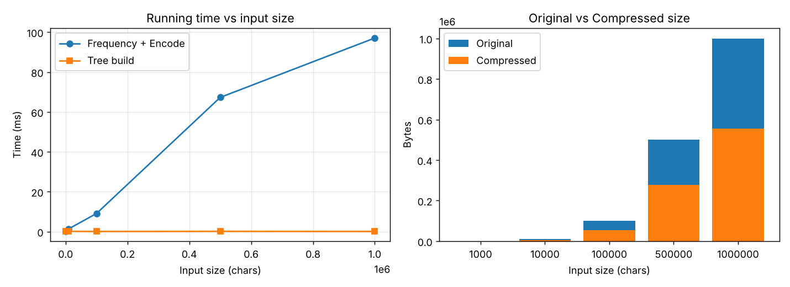

# Huffman Compressor - Python project + website

**Subject:** Design and Analysis of Algorithms (DAA) - Capstone Project 3: File Compression Using Huffman Coding
**Student:** Prashant Kanwal | B.Tech CSE (AIML), Section G | Roll No. 2501730468

A complete Huffman Coding project: the algorithm in Python (`huffman.py`), a command-line tool, analysis and
benchmarks, and a responsive **website** that compresses and restores real text files. The website is served by a
small Python server that runs the real `huffman.py` code.

## How to run (quick start)
Needs Python 3.8+ only. Nothing to install.

```bash
python server.py        # website opens at http://localhost:8000
```
On Windows you can also double-click `run.bat`. Press Ctrl+C in the terminal to stop.

No Python? Open `web/index.html` in a browser: the page then runs the same algorithm in JavaScript.
The page shows which engine it is using ("Python server" or "in-browser") under the title.

### Command line tool
```bash
python main.py demo                                   # step-by-step demo with tree
python main.py analyze samples/sample_large.txt       # code table + size comparison + entropy
python main.py compress samples/sample_large.txt out.huf
python main.py decompress out.huf restored.txt
python main.py benchmark                              # time vs size (+ benchmark.png if matplotlib is installed)
python -m unittest discover -s tests -v               # 16 tests
```

## How Huffman is used in the website
```
Browser (web/index.html)                     Python (server.py + huffman.py)
------------------------                     --------------------------------
1. user types text / chooses file
2. page builds frequency table, Huffman
   tree, codes and draws them (SVG)
3. user presses "Download .huf"  --------->  POST /api/compress
                                             huffman.compress_bytes(text):
                                               count frequencies -> min-heap tree
                                               -> codes -> encode -> pack bits + header
   <-------------------------------------    returns the .huf bytes, browser saves them
4. Restore tab: user picks a .huf file ----> POST /api/restore
                                             huffman.decompress_bytes(blob):
                                               read header -> rebuild same tree
                                               -> follow bits from root -> text
   <-------------------------------------    returns original text, browser offers download
```
* The **tree, code table and bit stream** you see are drawn in the browser by the same algorithm.
* The **downloaded `.huf` file and the restored text** come from `huffman.py` when the server is running.
* Both implementations write the identical `HUF1` file format, so output is byte-for-byte the same
  (for `samples/sample_large.txt` both give 15,363 bytes) and each can restore the other's files.

## Website features
* **Compress:** type text, choose a file or drag and drop; download the `.huf` file
* **Restore:** choose a `.huf` file; download the original text
* size comparison, space saved, average code length vs entropy, lossless check
* Huffman tree (SVG): left edge = 0, right edge = 1; hover a code row to light up its path
* code table and encoded bit stream; clear error messages; works on phones (responsive)
* limits: UTF-8 text files up to 3 MB

## Project structure
```
huffman.py     core algorithm (Node, tree, codes, encode/decode, bit packing, file format)
server.py      web server: serves the website + /api/compress and /api/restore (uses huffman.py)
web/index.html the website (HTML + CSS + JavaScript in one file)
run.bat        double-click launcher for Windows
main.py        command line tool
analysis.py    entropy, size comparison, benchmark and graph
tests/         16 unit tests (algorithm, edge cases, server API)
samples/       sample.txt, sample_large.txt
benchmark.png  time/size graph
VIVA_NOTES.md  viva questions and answers
```

## Algorithm (Greedy)
1. Count the frequency of every character.
2. Put each character in a min-heap keyed by frequency.
3. Repeatedly remove the 2 smallest nodes, merge into a parent (freq = sum), push back; the last node is the root.
4. Root to leaf: left = `0`, right = `1` gives each character's code (frequent characters get short codes).
5. Encode with the codes and pack bits into bytes; store the frequency table in the header.
6. Decode by rebuilding the same tree and following the bits from the root.

| Phase | Time | Space |
|---|---|---|
| Frequency count | O(n) | O(k) |
| Build tree (min-heap) | O(k log k) | O(k) |
| Generate codes | O(k) | O(k) |
| Encode / Decode | O(n) | O(n) / O(k) |
| **Overall** | **O(n + k log k)** | **O(k)** + output |

n = characters in the file, k = distinct characters.

## Results
| File | Original | Compressed | Space saved |
|---|---|---|---|
| samples/sample.txt | 1094 B | 981 B | 10.33 % |
| samples/sample_large.txt | 27350 B | 15363 B | 43.83 % |

Average code length 4.382 bits/char vs entropy 4.352 bits/char vs fixed 8 bits/char. Decompressed files are
byte-for-byte identical to the originals. Very small files save little because of the fixed header.



## Limitations
* Text (UTF-8) files only. Header stores the whole frequency table (canonical Huffman would shrink it).
* Huffman codes one symbol at a time, so it cannot use repeated phrases (unlike ZIP's LZ77 + Huffman).
